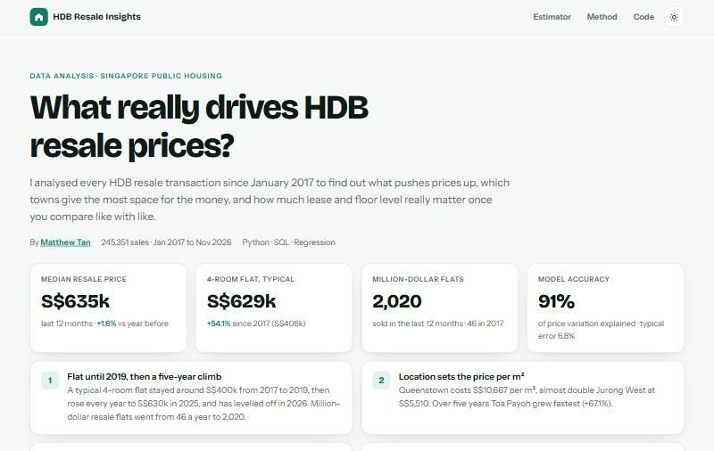

# HDB Resale Insights

**What really drives HDB resale prices?** An analysis of every HDB resale transaction since January 2017 (245,000+ sales), with an interactive dashboard and a fair-price estimator.

**Live dashboard:** https://yushenn.github.io/hdb-resale-insights/



## Key findings

Data from Jan 2017 to Nov 2026:

1. **Flat until 2019, then a five-year climb.** A typical 4-room flat sold for about S$400k from 2017 to 2019, then rose every year to about S$630k in 2025, and has levelled off in 2026. Million-dollar resale flats went from 46 in 2017 to over 2,000 in the last 12 months.
2. **Location sets the price per m².** Queenstown costs about S$10,700 per m², almost double Jurong West (about S$5,500). Over five years Toa Payoh grew fastest (+67%).
3. **Lease matters a lot.** Comparing like with like, a flat with 60 years left sells for about 68% of the same flat with 99 years left.
4. **High floors matter less than they look.** In the raw data, the top floors cost 2.1× more per m² than the lowest. But tall blocks are mostly in pricier towns. Holding town, size and lease fixed, each extra floor adds only about 0.8%.

Finding 4 shows why the raw averages can mislead: what looks like a "high floor premium" is mostly a location effect.

## How it works

| Step | Tool | What happens |
| --- | --- | --- |
| 1. Download | Python | `analysis/download.py` fetches the dataset from the data.gov.sg API |
| 2. Clean | pandas | Converts text like "61 years 04 months" into numbers, takes the middle of each storey range, works out price per m² |
| 3. Analyse | SQL (SQLite) | `analysis/queries.sql`: medians by month, town, lease band and storey band. SQLite has no `MEDIAN()`, so medians use window functions (`ROW_NUMBER`, `COUNT OVER`) |
| 4. Model | NumPy | Linear regression on log price with floor area, floor level, remaining lease, town, flat type and quarter |
| 5. Present | HTML, JavaScript, Chart.js | `index.html` reads `data.json` and draws the charts and estimator |

### The model

```
log(price) = b0 + b1·log(floor area) + b2·floor level + b3·lease + b4·lease²
             + town effect + flat type effect + quarter effect
```

Using log price means each coefficient works roughly like a percentage effect. I trained it on 80% of sales and tested it on the other 20% it had never seen:

- **R² = 0.91**: it explains 91% of the variation in prices.
- **Typical error = 6.8%**: half of its estimates are within 6.8% of the real price.

### Limitations

- The model doesn't know about renovation, the exact block, distance to MRT or the view.
- The latest month only includes sales registered so far.
- The model shows how prices move together with each factor, not why (correlation, not causation).

## Run it yourself

```bash
python -m venv venv
venv\Scripts\activate          # macOS/Linux: source venv/bin/activate
pip install -r requirements.txt
python analysis/download.py    # about 24 MB
python analysis/build.py       # writes data.json
python -m http.server          # open http://localhost:8000
```

## Project structure

```
analysis/
  download.py    get the data from data.gov.sg
  queries.sql    the SQL analysis
  build.py       clean, run SQL, fit the model, write data.json
data.json        results used by the dashboard
index.html       the dashboard
```

## Data and licence

Contains information from *Resale flat prices based on registration date from Jan-2017 onwards* (Housing & Development Board), accessed from [data.gov.sg](https://data.gov.sg), made available under the terms of the [Singapore Open Data Licence version 1.0](https://data.gov.sg/open-data-licence).

This is an independent student project, not valuation advice.
