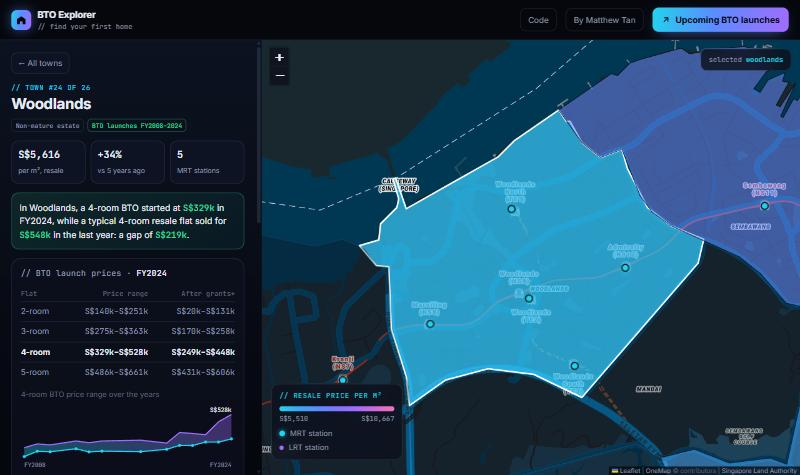

# BTO Explorer

**Where can we afford to live?** An interactive map that helps young couples in Singapore compare HDB towns: from most to least expensive, past BTO launch prices, what resale flats really cost, and the MRT stations and hawker centres nearby. Built entirely from official open data.

**Live site:** https://yushenn.github.io/bto-explorer/



## What you can do

- **See every town ranked** from most to least expensive by resale price per m² (last 12 months), coloured on the map.
- **Set your budget and flat type** to see where a typical resale flat fits, and where only a recent BTO launch (FY2020 onwards) fits.
- **Click a town** to see:
  - its BTO launch price ranges, including the price after grants, and how they've changed since FY2008
  - typical resale prices by flat type, with size and lease left
  - the gap between BTO and resale, for example *4-room in Woodlands: BTO from S$329k vs resale S$548k*
  - its MRT/LRT stations, hawker centres, and whether it's a mature estate
- **Check upcoming launches:** the "Upcoming BTO launches" button opens HDB's official Flat Portal, since there's no open dataset of future launches.

## Data

All from [data.gov.sg](https://data.gov.sg), under the Singapore Open Data Licence v1.0:

| Dataset | Agency | Used for |
| --- | --- | --- |
| Resale flat prices (Jan 2017 onwards) | HDB | Town ranking, typical prices |
| Price Range of HDB Flats Offered (FY2008–FY2024) | HDB | BTO launch prices |
| Master Plan 2019 Planning Area Boundary | URA | Town shapes on the map |
| MRT Station Exit | LTA | Station locations |
| Hawker Centres | NEA | Hawker centre locations |

Map tiles © [OneMap](https://www.onemap.gov.sg/) / Singapore Land Authority.

## How it works

| Step | Tool | What happens |
| --- | --- | --- |
| 1. Download | Python | `analysis/download.py` fetches all five datasets from the data.gov.sg API |
| 2. Prices | pandas + SQL (SQLite) | `analysis/queries.sql` calculates medians by town and flat type, using window functions because SQLite has no `MEDIAN()` |
| 3. Geography | Shapely | Simplifies town boundaries for the web, groups 613 station exits into 188 stations, and places stations and hawker centres in towns |
| 4. Present | Leaflet, JavaScript | `index.html` reads `data.json` and `areas.geojson` and draws the map, ranking and town details |

Notes and limits:
- HDB's BTO price table only covers the towns that had launches in each financial year, so not every town has BTO prices.
- "After grants" is the price less the AHG/SHG grants, as HDB published it. Today's grants are different.
- Central Area and Kallang/Whampoa span more than one URA planning area.
- Tengah is new and has no resale flats yet, so it isn't ranked.

## Run it yourself

```bash
python -m venv venv
venv\Scripts\activate          # macOS/Linux: source venv/bin/activate
pip install -r requirements.txt
python analysis/download.py
python analysis/build.py       # writes data.json and areas.geojson
python -m http.server          # open http://localhost:8000
```

This is an independent student project, not financial advice. Always confirm with HDB.
